# Class Activity 1 — System Calls in Practice

- **Student Name:** Hour Samnang
- **Student ID:** e20230372
- **Date:** 11/9/2026

---

## Warm-Up: Hello System Call

Screenshot of running `hello_syscall.c` on Linux:

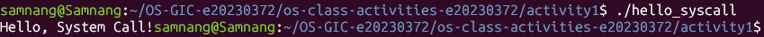

Screenshot of running `copyfilesyscall.c` on Linux:

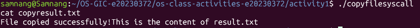

---

## Task 1: File Creator & Reader

### Part A — File Creator

**Describe your implementation:**

The library version uses `fopen()`, `fprintf()`, and `fclose()` to create and write to a file. The system call version uses `open()`, `write()`, and `close()` directly. Both programs create the same file and write the same message. However, the system call version requires me to specify the file flags and permissions manually.

**Version A — Library Functions (`file_creator_lib.c`):**

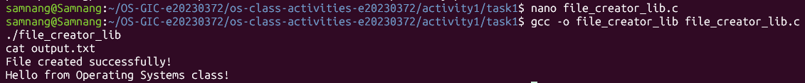

**Version B — POSIX System Calls (`file_creator_sys.c`):**

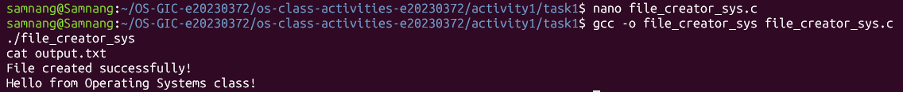

**Questions:**

1. **What flags did you pass to `open()`? What does each flag mean?**

   > I used `O_WRONLY | O_CREAT | O_TRUNC`.
   > - `O_WRONLY`: Opens the file for writing only.
   > - `O_CREAT`: Creates the file if it does not exist.
   > - `O_TRUNC`: Clears the existing content if the file already exists.

2. **What is `0644`? What does each digit represent?**

   > `0644` is an octal file permission value.
   > - First digit `0`: Indicates octal notation.
   > - Owner `6`: Read and write permissions.
   > - Group `4`: Read permission only.
   > - Others `4`: Read permission only.
   >
   > In symbolic form, it is `rw-r--r--`.

3. **What does `fopen("output.txt", "w")` do internally that you had to do manually?**

   > `fopen()` handles opening or creating the file in write mode and manages the file stream. In the system call version, I had to use `open()` with the appropriate flags and permissions, then manually close the file using `close()`.

### Part B — File Reader & Display

**Describe your implementation:**

The library version uses `fopen()` to open the file, `fgets()` to read its content, and `printf()` to display it. The system call version uses `open()` and a loop with `read()` to read data into a buffer, then `write()` to display it. Both versions successfully display the same message.

**Version A — Library Functions (`file_reader_lib.c`):**

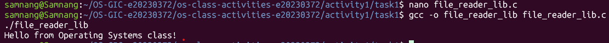

**Version B — POSIX System Calls (`file_reader_sys.c`):**

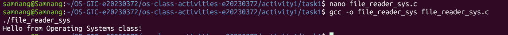

**Questions:**

1. **What does `read()` return? How is this different from `fgets()`?**

   > `read()` returns the number of bytes successfully read. It returns `0` when it reaches the end of the file and `-1` if an error occurs. `fgets()` returns a pointer to the buffer when successful or `NULL` when it reaches EOF or encounters an error.

2. **Why do you need a loop when using `read()`? When does it stop?**

   > A loop is needed because `read()` may return only part of the file at a time. The loop continues reading until all data has been read. It stops when `read()` returns `0`, meaning the end of the file has been reached, or when an error occurs.

---

## Task 2: Directory Listing & File Info

**Describe your implementation:**

The library version uses `opendir()`, `readdir()`, and `stat()` to list directory entries and display their file sizes using `printf()`. The system call version uses the same directory-reading functions but formats the output using `snprintf()` and displays it using `write()`. Both versions successfully list filenames and their sizes.

### Version A — Library Functions (`dir_list_lib.c`)

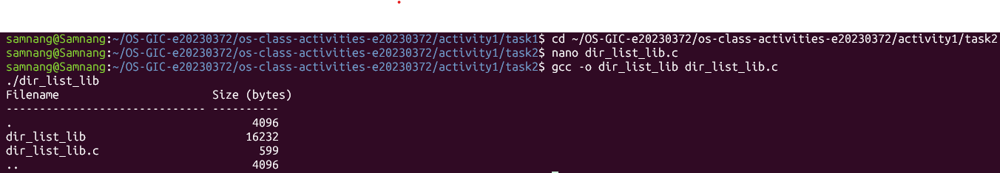

### Version B — System Calls (`dir_list_sys.c`)

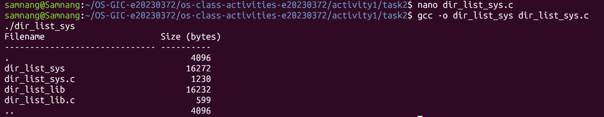

### Questions

1. **What struct does `readdir()` return? What fields does it contain?**

   > `readdir()` returns a pointer to a `struct dirent`. It contains information about a directory entry, including its filename (`d_name`), inode number (`d_ino`), entry type (`d_type`), and record length (`d_reclen`).

2. **What information does `stat()` provide beyond file size?**

   > `stat()` provides file metadata such as file type, permissions, inode number, owner ID, group ID, number of hard links, access time, modification time, and status change time.

3. **Why can't you `write()` a number directly — why do you need `snprintf()` first?**

   > `write()` outputs raw bytes, not formatted numbers. Therefore, I used `snprintf()` to convert the file size into a string and store it in a buffer before passing it to `write()`.

---

## Task 3: strace Analysis

**Describe what you observed:**

I used `strace` to observe the system calls made by both versions. I noticed that even though the programs produce the same output, their system call counts are different. The library version made 38 system calls, while the direct system call version made 34. I was also surprised that both versions used `openat()` instead of showing a simple `open()` call.

### strace Output — Library Version (File Creator)

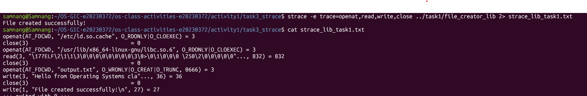

### strace Output — System Call Version (File Creator)

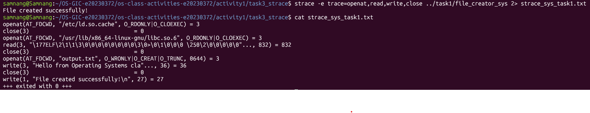

### strace Output — Library Version (File Reader)

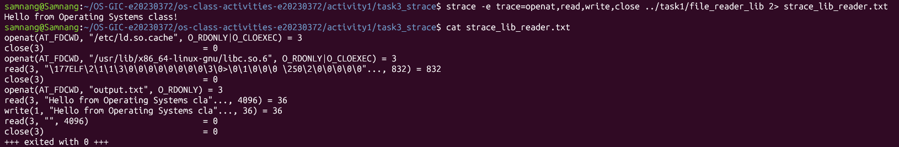

### strace Output — System Call Version (File Reader)

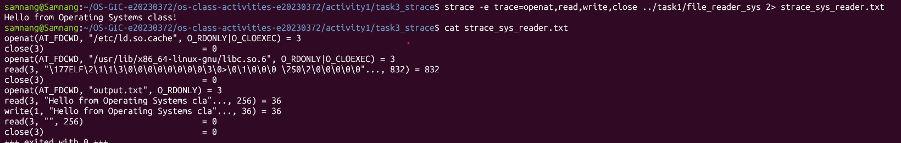

### strace -c Summary Comparison

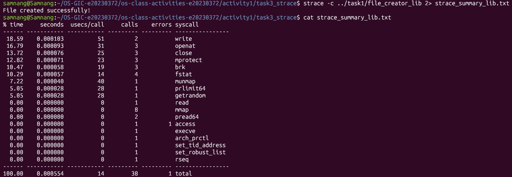

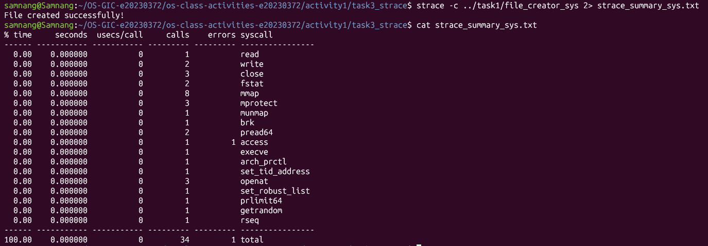

### Questions

1. **How many system calls does the library version make compared to the system call version?**

   > According to my `strace -c` results:
   > - Library version: 38 system calls.
   > - System call version: 34 system calls.
   >
   > The library version made 4 more system calls than the direct system call version in this test.

2. **What extra system calls appear in the library version? What do they do?**

   > The library version had higher counts for some calls:
   > - `fstat()`: 4 calls in the library version compared to 2 in the system call version. It retrieves file metadata.
   > - `brk()`: 3 calls compared to 1. It manages the program's heap memory.
   >
   > Both versions also used `mmap()` for memory mapping, with 8 calls each. It maps files or memory regions into a process's address space. These differences are from the observed runs and do not mean every library function always produces extra system calls.

3. **How many `write()` calls does `fprintf()` actually produce?**

   > In my file creator trace, writing the file content with `fprintf()` resulted in one `write()` system call of 36 bytes. There was also another separate `write()` call for the confirmation message displayed on the terminal.

4. **In your own words, what is the real difference between a library function and a system call?**

   > A library function is a function provided by a programming library that makes programming easier by handling operations for us. A system call is an interface that allows a program to request services directly from the operating system kernel. Library functions can use system calls internally to perform their operations.

---

## Task 4: Exploring OS Structure

### System Information

> 📸 Screenshot of `uname -a`, `/proc/cpuinfo`, `/proc/meminfo`, `/proc/version`, and `/proc/uptime`:

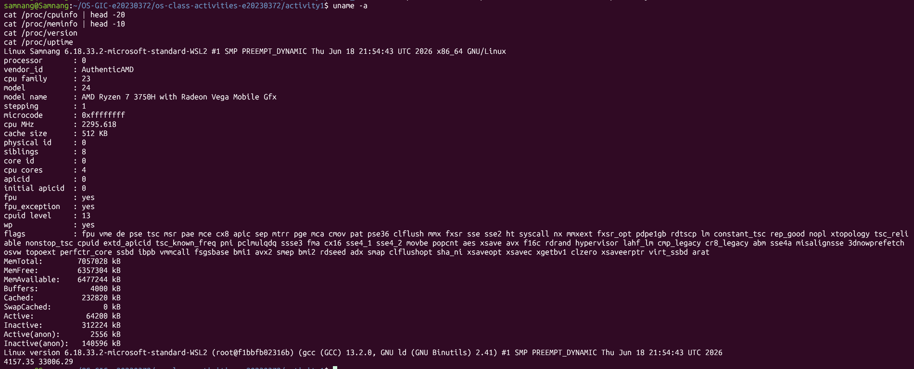

My system information:

- **Environment:** Ubuntu on WSL2
- **Kernel:** Linux 6.18.33.2-microsoft-standard-WSL2
- **CPU:** AMD Ryzen 7 3750H with Radeon Vega Mobile Gfx
- **CPU cores reported:** 4
- **Memory reported by WSL:** 7,057,028 KB (approximately 6.73 GiB)

### Process Information

> 📸 Screenshot of `/proc/self/status`, `/proc/self/maps`, `/proc/self/cmdline`, and `ps aux`:

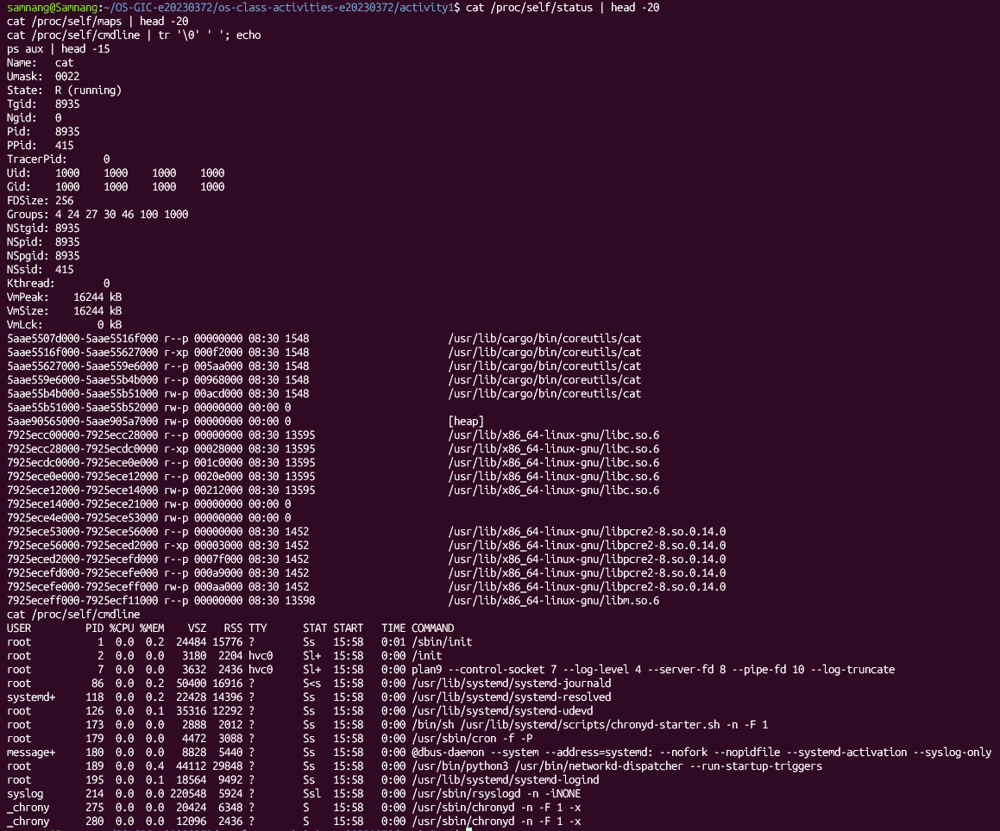

The process information showed the PID, process state, memory usage, memory mappings, and running processes. The `/proc/self` directory refers to the process accessing it. In my output, the process was `cat` with PID 8935.

### Kernel Modules

> 📸 Screenshot of `lsmod` and `modinfo`:

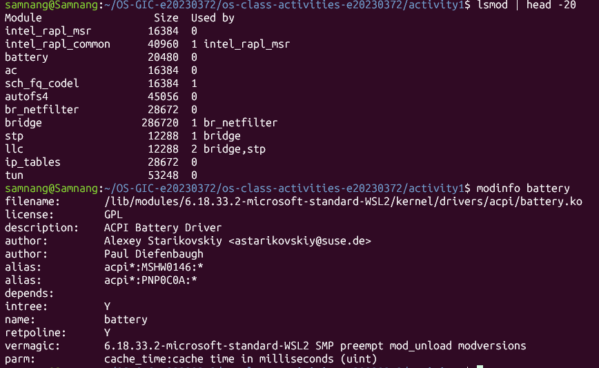

I used `lsmod` to list loaded kernel modules and `modinfo battery` to inspect the battery module.

Example module information:

- **Module:** `battery`
- **Description:** ACPI Battery Driver
- **License:** GPL
- **Kernel version:** 6.18.33.2-microsoft-standard-WSL2

### OS Layers Diagram

> 📸 Diagram of the OS layers:

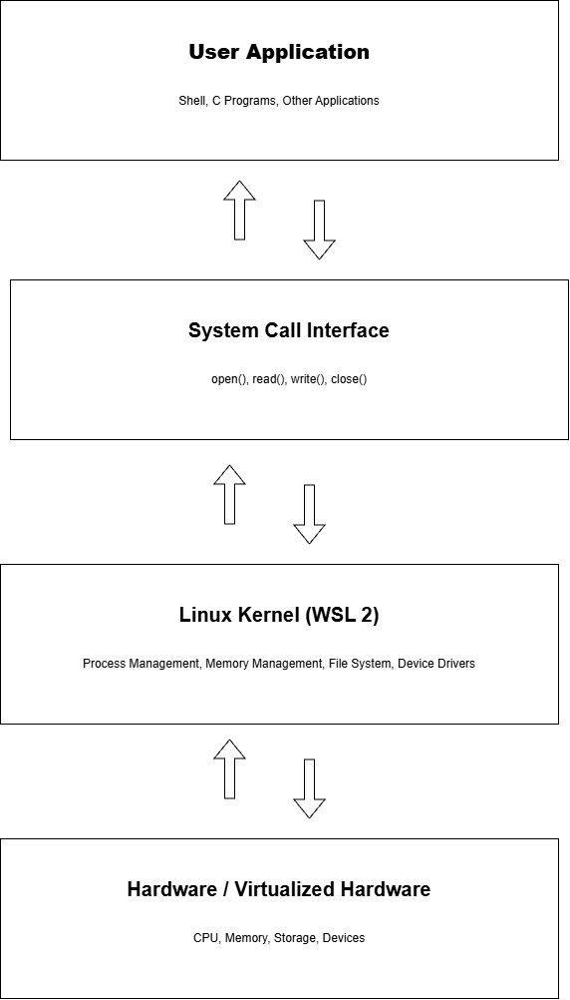

The diagram shows four main layers:

1. User Applications
2. System Call Interface
3. Linux Kernel (WSL2)
4. Hardware / Virtualized Hardware

My system uses an AMD Ryzen 7 3750H CPU, approximately 6.73 GiB of memory reported by WSL, and the Linux WSL2 kernel.

### Questions

1. **What is `/proc`? Is it a real filesystem on disk?**

   > `/proc` is a virtual filesystem in Linux that provides information about running processes and the operating system. It is not a real filesystem stored on a disk. Its contents are generated dynamically by the kernel.

2. **Monolithic kernel vs. microkernel — which type does Linux use?**

   > Linux uses a monolithic kernel. Most core operating system services, such as process management, memory management, and device drivers, run in kernel space. Linux also supports loadable kernel modules.

3. **What memory regions do you see in `/proc/self/maps`?**

   > I observed memory mappings for the executable program, shared libraries such as `libc.so.6` and `libpcre2`, and the heap. The mappings also show memory permissions such as read, write, and execute.

4. **Break down the kernel version string from `uname -a`.**

   > My kernel version string is `6.18.33.2-microsoft-standard-WSL2`.
   > - `6`: Major kernel version.
   > - `18`: Minor kernel version.
   > - `33.2`: Additional kernel version and patch information.
   > - `microsoft-standard-WSL2`: Identifies the Microsoft WSL2 kernel build.
   >
   > The output also shows the build number, SMP support, preemption configuration, build date, CPU architecture (`x86_64`), and operating system (`GNU/Linux`).

5. **How does `/proc` show that the OS is an intermediary between programs and hardware?**

   > `/proc` allows programs to obtain information about processes, memory, and kernel resources through a standard interface. Programs do not need to access hardware directly to obtain this information. Instead, the kernel manages the hardware and provides information through `/proc`.

---

## Reflection

This activity helped me understand the difference between library functions and system calls in Linux. I learned how to create, read, and write files using both approaches, and how to inspect the actual system calls using `strace`.

The most surprising part was that two programs could produce exactly the same output but make different numbers of system calls. I also learned that library functions can perform additional work internally, such as buffering and memory management.

Finally, exploring `/proc` helped me understand how Linux provides information about processes, memory, and kernel resources. Overall, this activity gave me a better understanding of how programs interact with the operating system and how the kernel manages system resources.
