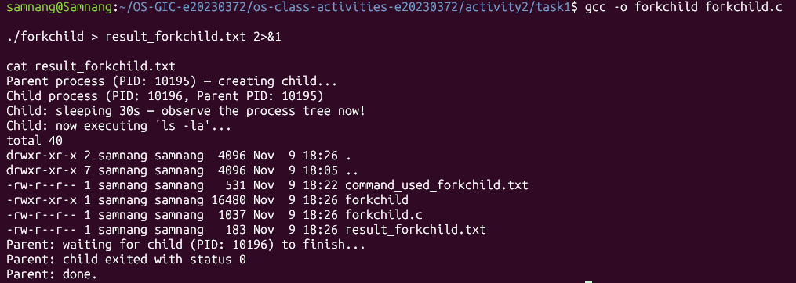
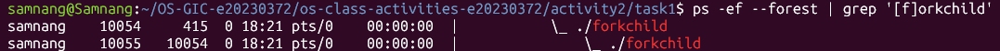
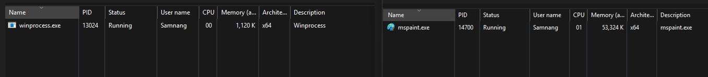
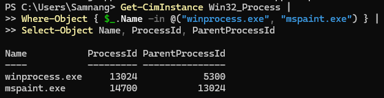
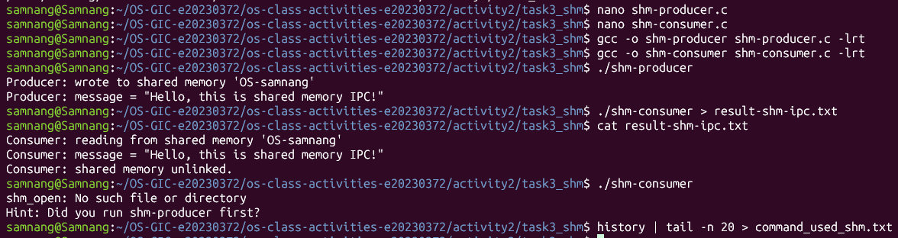
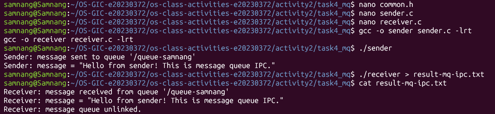

# Class Activity 2 — Processes & Inter-Process Communication

- **Student Name:** Samnang
- **Student ID:** e20230372
- **Date:** 9/11/26

---

## Task 1: Process Creation on Linux (fork + exec)

### Compilation & Execution

Screenshot of compiling and running `forkchild.c`:



### Process Tree

Screenshot of the parent-child process tree:



### Output

```text
Parent process (PID: 10195) — creating child...
Child process (PID: 10196, Parent PID: 10195)
Child: sleeping 30s — observe the process tree now!
Child: now executing 'ls -la'...
total 40
drwxr-xr-x 2 samnang samnang  4096 Nov  9 18:26 .
drwxr-xr-x 7 samnang samnang  4096 Nov  9 18:05 ..
-rw-r--r-- 1 samnang samnang   531 Nov  9 18:22 command_used_forkchild.txt
-rwxr-xr-x 1 samnang samnang 16480 Nov  9 18:26 forkchild
-rw-r--r-- 1 samnang samnang  1037 Nov  9 18:26 forkchild.c
-rw-r--r-- 1 samnang samnang   183 Nov  9 18:26 result_forkchild.txt
Parent: waiting for child (PID: 10196) to finish...
Parent: child exited with status 0
Parent: done.
```

### Questions

**1. What does `fork()` return to the parent? What does it return to the child?**

`fork()` returns the child's PID to the parent process. In the child process, it returns `0`. If it fails, it returns `-1`.

**2. What happens if you remove the `waitpid()` call? Why might the output look different?**

The parent will not wait for the child to finish. It may exit before the child, so the output order can change. The child may also temporarily become an orphan process.

**3. What does `execlp()` do? Why don't we see "execlp failed" when it succeeds?**

`execlp()` replaces the current process program with another program. In this task, it replaces the child process with `ls -la`. We don't see an execution failure message because `execlp()` does not return when it succeeds.

**4. Draw the process tree for your program (parent → child). Include PIDs from your output.**

```text
Parent process
PID: 10195
    |
    └── Child process
        PID: 10196
        Parent PID: 10195
```

**5. Which command did you use to view the process tree (`ps --forest`, `pstree`, or `htop`)? What information does each column show?**

I used `ps -ef --forest | grep '[f]orkchild'` to view the process tree.

The columns show:
- UID: Process owner.
- PID: Process ID.
- PPID: Parent process ID.
- C: CPU usage information.
- STIME: Process start time.
- TTY: Terminal associated with the process.
- TIME: CPU time used.
- CMD: Command used to start the process.

---

## Task 2: Process Creation on Windows

### Compilation & Execution

Screenshot of compiling and running `winprocess.c`:


### Task Manager Screenshots

Screenshot showing the processes:



Screenshot showing the process information:



### Questions

**1. What is the key difference between how Linux creates a process (`fork` + `exec`) and how Windows does it (`CreateProcess`)?**

Linux uses `fork()` to create a copy of the calling process, then `exec()` replaces the child process with a new program. Windows uses `CreateProcess()` to create a new process and its primary thread directly.

**2. What does `WaitForSingleObject()` do? What is its Linux equivalent?**

`WaitForSingleObject()` makes the parent wait until the specified object, in this case the child process, finishes. Its Linux equivalent is `waitpid()`.

**3. Why do we need to call `CloseHandle()` at the end? What happens if we don't?**

`CloseHandle()` releases the process and thread handles after they are no longer needed. If we don't close them, the program can leak system resources.

**4. In Task Manager, what was the PID of your parent program and the PID of mspaint? Do they match your program's output?**

The parent program (`winprocess.exe`) had PID `13024`, and `mspaint.exe` had PID `14700`. Paint's Parent PID was also `13024`, confirming that it was created by our program. The PIDs matched the process information from the program.

**5. Compare the Processes tab (tree view) and the Details tab (PID/PPID columns). Which view makes it easier to understand the parent-child relationship? Why?**

I find the Processes tab easier to understand because it displays processes in a visual hierarchy. However, the Details tab provides exact PID and Parent PID values, which are useful for verifying the relationship.

---

## Task 3: Shared Memory IPC

### Compilation & Execution

Screenshot of compiling and running `shm-producer` and `shm-consumer`:



### Output

```text
Consumer: reading from shared memory 'OS-samnang'
Consumer: message = "Hello, this is shared memory IPC!"
Consumer: shared memory unlinked.
```

### Questions

**1. What does `shm_open()` do? How is it different from `open()`?**

`shm_open()` creates or opens a POSIX shared memory object. Unlike `open()`, which normally accesses regular files, `shm_open()` accesses named shared memory objects used for communication between processes.

**2. What does `mmap()` do? Why is shared memory faster than other IPC methods?**

`mmap()` maps the shared memory object into a process's address space. Shared memory is faster because processes can access the same memory region directly without repeatedly copying data between them.

**3. Why must the shared memory name match between producer and consumer?**

Both programs must use the same name to access the same shared memory object. If the names are different, the consumer cannot find the memory created by the producer.

**4. What does `shm_unlink()` do? What would happen if the consumer didn't call it?**

`shm_unlink()` removes the shared memory object's name. If the consumer doesn't call it, the object may remain available in the system and can continue using system resources until it is removed.

**5. If the consumer runs before the producer, what happens? Try it and describe the error.**

The consumer fails because the shared memory object does not exist yet. The program displays:

```text
shm_open: No such file or directory
Hint: Did you run shm-producer first?
```

The producer must run first to create the shared memory object.

---

## Task 4: Message Queue IPC

### Compilation & Execution

Screenshot of compiling and running `sender` and `receiver`:



### Output

```text
Receiver: message received from queue '/queue-samnang'
Receiver: message = "Hello from sender! This is message queue IPC."
Receiver: message queue unlinked.
```

### Questions

**1. How is a message queue different from shared memory? When would you use one over the other?**

A message queue allows processes to exchange separate messages through a queue managed by the operating system. Shared memory allows processes to access the same memory region directly.

I would use message queues when sending separate messages between processes. I would use shared memory when transferring larger amounts of data efficiently.

**2. Why does the queue name in `common.h` need to start with `/`?**

POSIX message queue names must start with a forward slash (`/`). This is part of the naming convention required by the POSIX message queue interface.

**3. What does `mq_unlink()` do? What happens if neither the sender nor receiver calls it?**

`mq_unlink()` removes the message queue's name. If neither program calls it, the queue may remain in the system and continue using resources.

**4. What happens if you run the receiver before the sender?**

The receiver fails because the message queue has not been created. It displays:

```text
mq_open: No such file or directory
Hint: Did you run sender first?
```

The sender must run first to create the queue.

**5. Can multiple senders send to the same queue? Can multiple receivers read from the same queue?**

Yes. Multiple senders can send messages to the same queue, and multiple receivers can receive messages from it. Each received message is removed from the queue, so it is received by one receiver rather than broadcast to all receivers.

---

## Reflection

Through this activity, I learned how processes are created in Linux and Windows and how different processes can communicate with each other.

The most interesting difference was that Linux uses `fork()` and `exec()` to create and run a child process, while Windows uses `CreateProcess()` to create a new process directly.

I also learned about shared memory and message queues. I prefer shared memory when transferring large amounts of data because it allows processes to access the same memory directly. However, message queues are easier to use when exchanging separate messages between processes.

Overall, this activity helped me understand process creation, process relationships, and inter-process communication in both operating systems.
