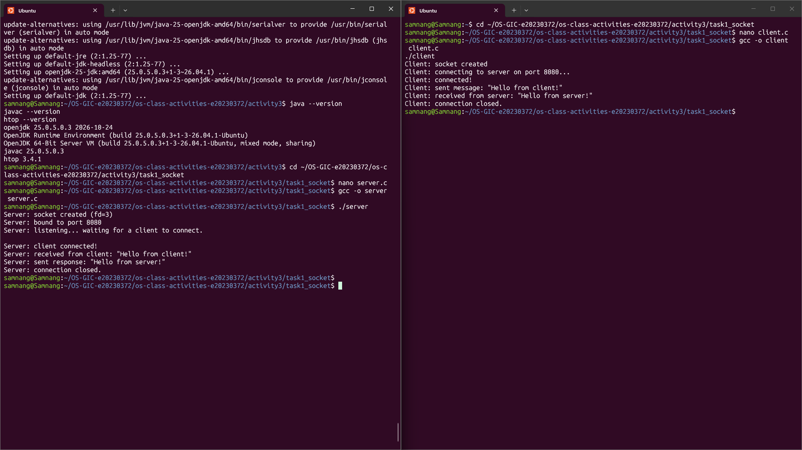
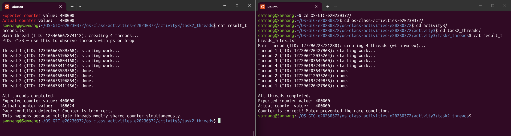
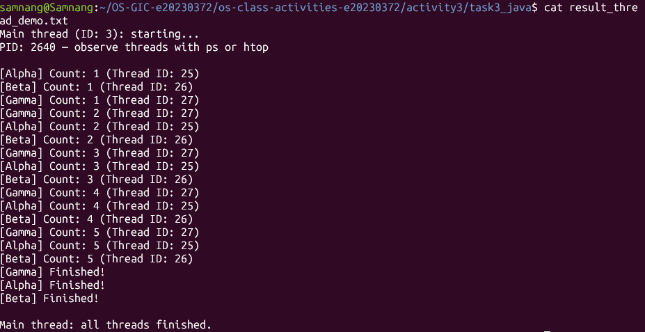
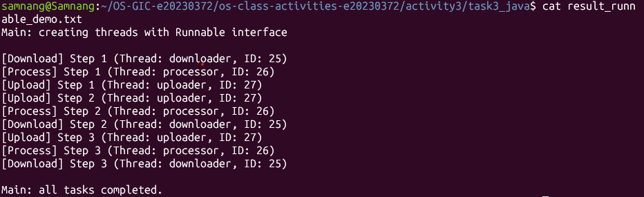
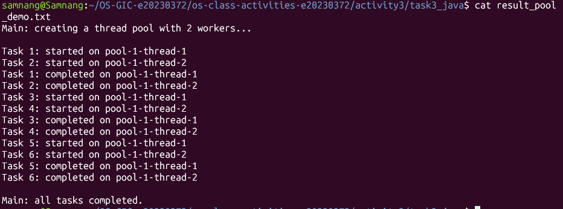
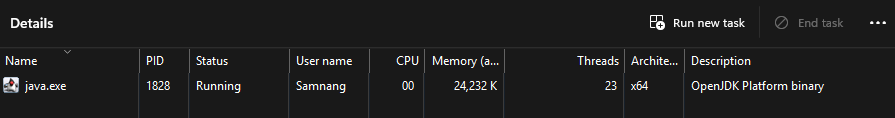

# Class Activity 3 — Socket Communication & Multithreading

- **Student Name:** Samnang
- **Student ID:** e20230372
- **Date:** November 18, 2026

---

## Task 1: TCP Socket Communication (C)

### Compilation & Execution

The TCP server and client were compiled using GCC and executed successfully on Ubuntu. The server listened on port 8080, accepted the client's connection, received a message, and sent a response.



### Answers

**1. What is the role of `bind()` in the server? Why doesn't the client call `bind()`?**

`bind()` assigns an IP address and port number to the server socket so clients know where to connect. The client does not need to call `bind()` because the operating system automatically assigns a local IP address and an available port when connecting.

**2. What does `accept()` return? How is it different from the original server socket?**

`accept()` returns a new socket file descriptor used to communicate with the connected client. The original server socket remains responsible for listening for incoming connections.

**3. What happens if you start the client before the server?**

When the client starts before the server, the connection fails with a "Connection refused" error because no server is listening on port 8080.

**4. What does `htons(PORT)` do? Why is byte order conversion needed?**

`htons()` converts a 16-bit port number from host byte order to network byte order (big-endian). This ensures that computers with different byte orders interpret the port number correctly.

**5. Draw the sequence of socket calls for both server and client.**

```text
SERVER                         CLIENT
  |                              |
socket()                       socket()
  |                              |
bind()                         connect()
  |                              |
listen()                         |
  |                              |
accept() <-----------------------|
  |                              |
read() <---------------------- send()
  |                              |
send() ----------------------> read()
  |                              |
close()                        close()
  |                              |
```

### Task 1 Result

The server and client successfully exchanged messages through TCP sockets using localhost (127.0.0.1) and port 8080.

Output files:
- `task1_socket/result_socket.txt`
- `task1_socket/result_server.txt`
- `task1_socket/result_client.txt`
- `task1_socket/command_used_socket.txt`

---

## Task 2: POSIX Threads on Linux (C)

### Compilation & Execution

The programs were compiled using GCC with the `-pthread` flag. Four worker threads were created to increment a shared counter 100,000 times each.

### Without Mutex — Race Condition



The expected counter value was 400,000, but the actual value was different in each execution.

| Run | Expected | Actual |
|---|---:|---:|
| 1 | 400000 | 168731 |
| 2 | 400000 | 182442 |
| 3 | 400000 | 201991 |
| 4 | 400000 | 140074 |
| 5 | 400000 | 167337 |

### With Mutex — Correct Result

After implementing a mutex, all five executions returned the correct counter value of 400,000.

### Answers

**1. What is a race condition? Why does `shared_counter` produce an incorrect result?**

A race condition happens when multiple threads access and modify shared data at the same time without proper synchronization. In `threads.c`, all four threads increment the same counter, causing some updates to be lost and producing an incorrect final result.

**2. What does `pthread_mutex_lock()` do? Why does it fix the race condition?**

`pthread_mutex_lock()` locks a mutex so only one thread can enter the protected section at a time. Other threads must wait until the mutex is unlocked. This prevents simultaneous updates to `shared_counter` and ensures the correct result.

**3. What happens if you forget to call `pthread_join()`?**

Without `pthread_join()`, the main thread does not wait for the worker threads to finish.

During the experiment, the program printed "All threads completed" before Thread 4 started working. The counter was only 63,052 instead of 400,000.

This shows that the main thread can continue and terminate the process before the worker threads complete their tasks.

**4. How is a thread different from a process? What do threads share, and what is private to each thread?**

A process is an independent running program with its own memory space. A thread is a smaller unit of execution within a process.

Threads belonging to the same process share memory, code, heap, and open files. However, each thread has its own stack, registers, and execution state.

### Task 2 Result

The experiment demonstrated a race condition when multiple threads modified shared data without synchronization. Using a mutex prevented lost updates and produced the correct counter value of 400,000.

Output files:
- `task2_threads/result_threads.txt`
- `task2_threads/result_threads_mutex.txt`
- `task2_threads/command_used_threads.txt`

---

## Task 3: Java Multithreading

### 1. Creating Threads by Extending Thread

The `ThreadDemo.java` program creates three threads named Alpha, Beta, and Gamma. Each thread counts from 1 to 5.

The output shows that the threads execute concurrently, with their messages appearing in different orders.



### 2. Creating Threads Using Runnable

The `RunnableDemo.java` program uses the `Runnable` interface to create three tasks: Download, Process, and Upload.

Each task executes three steps using its own thread.



### 3. Using a Thread Pool

The `PoolDemo.java` program creates a fixed thread pool containing two worker threads to execute six tasks.

The results show that the same two threads are reused to complete all six tasks.



### Questions and Answers

**1. What is the difference between extending Thread and implementing Runnable?**

Extending `Thread` means creating a subclass of the Thread class. Implementing `Runnable` means defining a task that can be executed by a thread.

`Runnable` is more flexible because Java allows a class to implement multiple interfaces but extend only one class.

**2. What is the purpose of the `start()` method? How is it different from calling `run()` directly?**

The `start()` method creates a new thread of execution, which then executes the `run()` method.

Calling `run()` directly executes it like a normal method on the current thread without creating a new thread.

**3. What is a thread pool? Why is it useful?**

A thread pool is a collection of reusable worker threads.

It improves efficiency by reducing the overhead of repeatedly creating and destroying threads. It also controls how many tasks can execute simultaneously.

In our experiment, six tasks were completed using only two worker threads.

**4. What is the purpose of `join()` in Java?**

The `join()` method makes the calling thread wait until another thread finishes.

In `ThreadDemo.java` and `RunnableDemo.java`, the main thread uses `join()` to wait for all worker threads before printing the final completion message.

### Task 3 Result

All three Java programs compiled and executed successfully.

The experiments demonstrated different ways to create threads, execute tasks concurrently, and reuse threads through a fixed thread pool.

Output files:
- `task3_java/result_thread_demo.txt`
- `task3_java/result_runnable_demo.txt`
- `task3_java/result_pool_demo.txt`
- `task3_java/command_used_java.txt`

---

## Task 4: Observing Threads on Linux and Windows

### 1. Observing Threads Using `ps`

We created a C program named `threads_observe.c` that starts four worker threads and keeps them running for 60 seconds.

Using `ps -T -p <PID>`, we observed five threads belonging to the same process: one main thread and four worker threads.

All five threads shared the same PID but had different SPIDs (thread IDs).

### 2. Observing Threads Using `/proc`

We inspected the `/proc/<PID>/task/` directory and found five thread IDs.

The `/proc/<PID>/status` file also reported:

`Threads: 5`

This confirmed that Linux recognized all five threads.

### 3. Observing Threads Using `htop`

We used `htop` to observe the running threads visually.

The screenshot shows the main thread and four worker threads.


### 4. Observing Kernel Threads

We attempted to find Linux kernel threads using `ps`, searching for `kthreadd`, `kworker`, and `ksoftirqd`.

No matching kernel threads were visible.

The command `systemd-detect-virt` returned `wsl`, confirming that Ubuntu was running inside Windows Subsystem for Linux.

This environment did not expose the expected kernel-thread entries in the process listing.

### 5. Observing Java Threads in Windows

We ran `ThreadObserve.java` using Windows OpenJDK 25 and inspected the running process in Windows Task Manager.

The observed results were:

- Process: `java.exe`
- PID: 1828
- Status: Running
- Thread count: 23

The JVM creates additional internal threads beyond the three worker threads defined in the Java program.



### Questions and Answers

**1. What is the difference between a process ID (PID) and a thread ID (TID)?**

A PID identifies a process, while a TID identifies an individual thread. Multiple threads can belong to the same process.

**2. Why do all threads in the C program have the same PID?**

All four worker threads were created inside the same process. They share the process's address space and resources, so they belong to the same process.

**3. What does the `/proc/<PID>/task/` directory contain?**

It contains a subdirectory for each thread belonging to the process. Each subdirectory is named using that thread's Linux thread ID.

**4. How can `ps` and `htop` be used to observe threads?**

The `ps -T -p <PID>` command lists the threads belonging to a process, including their thread IDs.

`htop` provides an interactive view of running processes and threads, including CPU and memory usage.

**5. What are kernel threads?**

Kernel threads are threads used by the Linux kernel to perform operating system tasks, such as background processing and hardware-related work.

In this experiment, the expected kernel threads were not visible in the WSL environment.

**6. Why does Java show more threads than the program explicitly creates?**

The JVM creates internal threads for tasks such as garbage collection, compilation, and runtime management.

Our Windows Task Manager observation showed 23 threads even though the Java program explicitly created only three worker threads.

**7. What is the difference between user threads and kernel threads?**

User threads execute application code, while kernel threads perform operating system work.

Linux schedules application threads using kernel-supported execution mechanisms. Kernel threads execute kernel code rather than normal application code.

### Task 4 Result

The experiment demonstrated how to inspect threads using `ps`, `/proc`, `htop`, and Windows Task Manager.

We successfully observed five threads in the C program and 23 threads in the Windows Java process.

We also identified a limitation of our WSL environment when inspecting kernel threads.

Result files:
- `task2_threads/result_ps_threads.txt`
- `task2_threads/result_proc_threads.txt`
- `task2_threads/result_kernel_threads.txt`

---

## Reflection

In this activity, I learned how processes and threads communicate and execute concurrently.

I implemented TCP socket communication in C, explored race conditions and mutex synchronization using POSIX threads, and created Java threads using the Thread class, Runnable interface, and thread pools.

I also learned how to inspect running threads using Linux tools and Windows Task Manager.

The most important lesson was that multithreading requires proper synchronization. Without it, shared data can become inconsistent. I also learned that threads share process resources but have their own execution states.

Overall, this activity helped me better understand socket communication, thread management, synchronization, and operating system process monitoring.
