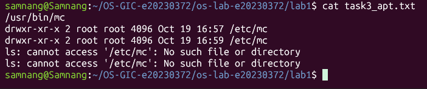
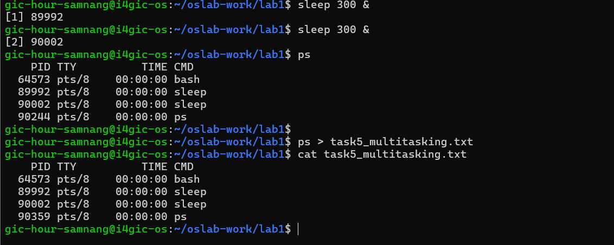
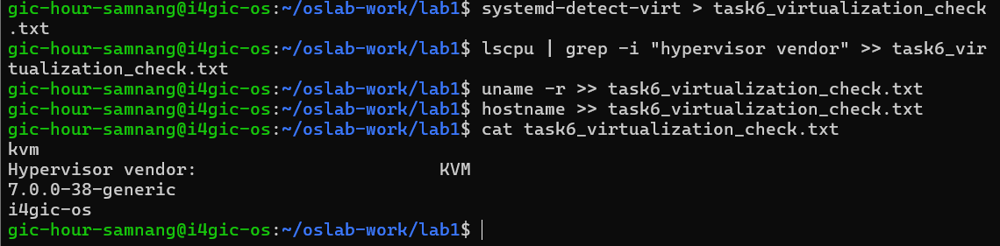

# OS Lab 1 Submission

Copy this template to `os-lab-YOUR_ID/lab1/README.md` in your own repository. Follow [the instructions](lab1-instruction.md). Your prediction and checkpoint answers are already saved by `oslab`; do not copy them here.

- **Student Name: Hour Samnang** 
- **Student ID: e20230372**
- **Ubuntu username on the server: gic-hour-samnang**
- **My values** (`oslab values lab1`): file1 = candle, file2 = panda, count = 2

---

## Task 1: Operating System Identification

Briefly describe what you observed about your OS and kernel. Which number is the kernel version, and which is the distribution version?

<!-- You may show the contents of task1_os_info.txt here; no screenshot needed. -->
I used the uname and lsb_release commands to identify my operating system. The kernel version is 7.0.0-38-generic, while the Linux distribution is Ubuntu 26.04.1 LTS.
This shows that the kernel version and distribution version are two different things.

---

## Task 2: Essential Linux File and Directory Commands

Briefly describe your experience creating, copying, renaming and deleting files. What did the last `ls` show?

<!-- You may show the contents of task2_file_commands.txt here; no screenshot needed. -->
I practiced creating, copying, renaming, and deleting files using Linux commands. I created candle.txt and panda.txt, copied the candle file, renamed the panda file, and deleted the copied file.
The final ls output showed candle.txt and panda_renamed.txt.
---

## Task 3: Package Management Using APT

Explain the difference you observed between `remove` and `purge`.

I installed Midnight Commander (mc) using APT and checked its executable path and configuration directory. After using apt-get remove, the configuration directory /etc/mc still existed.
However, after using apt-get purge, the directory was deleted. This demonstrates that remove keeps configuration files while purge removes them.
<!-- SCREENSHOT REQUIREMENT: your terminal after the purge, showing `ls -ld /etc/mc` and your prompt. -->

---

## Task 4: Programs vs Processes

Briefly describe how you ran a background process and found it in the process list. What is the difference between a program and a process? What did you see before, during and after?

I started a background process using the sleep command and used ps to view the running processes. The process list showed bash, sleep, and ps.
A program is a set of instructions stored on disk, while a process is an instance of a program currently being executed. In this example, sleep is the program and its running instance is the process.
---

## Task 5: Multitasking

Briefly describe the multitasking you saw. How many `sleep` lines did `ps` show? What does that show about the system, and what does it **not** show about how the processor is shared?

I started two background sleep processes using sleep 300 &. When I ran ps, it displayed two sleep processes running at the same time.
This shows that Linux can manage multiple processes concurrently. However, the output does not prove that both processes execute on the CPU at the exact same time,
because the operating system schedules CPU time between processes.
<!-- SCREENSHOT REQUIREMENT: your terminal with the `ps` result and your prompt. -->

---

## Task 6: Virtualization and Hypervisor Detection

State whether your system is running on a virtual machine or physical hardware, based on the command outputs.

The systemd-detect-virt command returned kvm, indicating that the system is running inside a KVM virtual machine. The lscpu output also identified KVM as the hypervisor vendor.
Therefore, my course server is a virtual machine rather than a physical machine running directly on hardware.
<!-- SCREENSHOT REQUIREMENT: your terminal with the output of the four commands and your prompt. -->

---

## My Prediction: Confirmed or Corrected

For each prediction answer (`oslab predict lab1`), write **confirmed** or **corrected** and what you saw that shows it. You test the third answer (`apt-get remove`) in Task 3.

Confirmed — I predicted that ps would show 2 lines containing sleep. After running two background sleep processes, the result showed 2 sleep processes.

Confirmed — I predicted that the sleep program would remain on disk after all its processes finished. This was correct because finishing a process does not delete the program file.

Corrected — I initially predicted that apt-get remove would delete the package's configuration folder. However, after testing, I found that /etc/mc still existed after removal.
It was only deleted after running apt-get purge.
---

## Plus / Challenge (only if you did them)

Your answers.

## AI Note (optional)

One suggestion an AI tool gave you and how you checked it.
